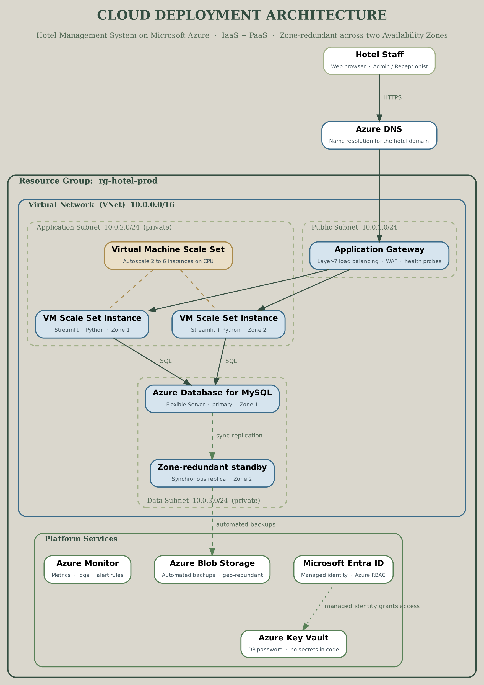

# Hotel Management System — Deployment on Microsoft Azure

**22AIE303 · Cloud Computing · Team 03**
Amrita Vishwa Vidyapeetham, Coimbatore

| Roll Number | Name |
|---|---|
| CB.SC.U4AIE24116 | J. Lakshmi Tejaswi |
| CB.SC.U4AIE24130 | Vishnu Teja |
| CB.SC.U4AIE24135 | Mithul Akshay |
| CB.SC.U4AIE24136 | Mohan Innani |

---

## Overview

A three-tier hotel management application — Streamlit front end, Python data access layer, MySQL database — migrated from a single local machine onto Microsoft Azure.

The application itself is unchanged. What this project adds is the infrastructure underneath it: a virtual network with isolated tiers, a managed database, autoscaling compute across two Availability Zones, secrets in a vault instead of in source control, and the whole environment declared as code that can be built and destroyed with one command each.

## Problem statement

Running the system on one machine means a single point of failure, no remote access, capacity fixed by the hardware purchased, backups that depend on someone remembering, and a database password sitting in plain text in the repository. Each of those is addressed below.

---

## Architecture



| Tier | Subnet | Components |
|---|---|---|
| Entry | `10.0.1.0/24` public | Application Gateway v2, zone-redundant public IP |
| Application | `10.0.2.0/24` private | VM Scale Set, 2–6 Ubuntu 22.04 instances across Zones 1 and 2 |
| Data | `10.0.3.0/24` private, delegated | Azure Database for MySQL Flexible Server |
| Platform | outside the VNet | Key Vault, Azure Monitor, Blob Storage, Microsoft Entra ID |

Only the Application Gateway is reachable from the internet. The VMs have no public IP; the database has no public endpoint and is resolved through a private DNS zone linked only to this network.

## Service and deployment models

| Model | Where it appears |
|---|---|
| **IaaS** | VM Scale Sets run the application; we manage the OS and runtime |
| **PaaS** | Azure Database for MySQL — Azure patches, backs up and fails over the engine |
| **SaaS** | The finished system, delivered to hotel staff as a URL |

Deployed to **public cloud**: no capital expenditure, Availability Zones available immediately, and resources can be created and destroyed as needed. A private or hybrid model would be the right answer only if guest identity documents were legally required to stay on premises.

---

## Repository layout

```
.
├── infra/                     Infrastructure as Code
│   ├── main.bicep             Orchestrates all modules
│   ├── main.parameters.json   Fill in before deploying
│   ├── modules/
│   │   ├── network.bicep      VNet, 3 subnets, 3 NSGs
│   │   ├── keyvault.bicep     Key Vault + password secret
│   │   ├── database.bicep     MySQL Flexible Server, private DNS
│   │   ├── gateway.bicep      Application Gateway v2
│   │   ├── compute.bicep      Scale set, identity, autoscale
│   │   └── monitoring.bicep   Log Analytics, alerts
│   ├── cloud-init.yaml        VM bootstrap
│   ├── deploy.sh              Build everything
│   ├── load-schema.sh         Import SQL from inside the VNet
│   └── destroy.sh             Tear everything down
├── src/                       Application source
│   ├── app_streamlit.py       Web front end
│   ├── app.py                 Tkinter fallback front end
│   ├── database.py            Data access layer — all SQL lives here
│   └── db_config.py           Local config (overwritten on Azure)
├── database/
│   └── 01_schema.sql          Tables, views, triggers, procedure, seed data
└── docs/                      Diagrams, report, presentation
```

---

## Prerequisites

- An Azure subscription (Azure for Students works)
- [Azure CLI](https://aka.ms/azure-cli), signed in with `az login`
- An SSH key pair — `deploy.sh` generates one if you have none
- Bash. On Windows use WSL or Git Bash

---

## Deployment

**1. Fork or clone this repository** and make it public, so the VMs can clone it at boot.

**2. Fill in the parameters.**

```bash
cd infra
cp main.parameters.json my.parameters.json
```

Edit `my.parameters.json` and replace every `REPLACE_WITH` placeholder:

| Parameter | What to put |
|---|---|
| `adminSshPublicKey` | Contents of `~/.ssh/id_rsa.pub` |
| `repositoryUrl` | Your repository's HTTPS clone URL |
| `alertEmail` | Where monitoring alerts should go |

**3. Deploy.**

```bash
PARAM_FILE=my.parameters.json ./deploy.sh
```

The script creates the resource group, validates the template before spending anything, deploys, then loads the database schema. Expect **15–25 minutes** — the Application Gateway is the slow part.

When it finishes it prints the application URL. Instances need a few more minutes to install packages before the gateway reports them healthy.

**4. Tear it down when you're finished.**

```bash
./destroy.sh rg-hotel-prod
```

> An idle Application Gateway bills by the hour. Destroy the environment after each demonstration — that's the main reason this project is defined as code rather than clicked together in the portal.

---

## Verifying without deploying

The templates compile without an Azure subscription:

```bash
az bicep build --file infra/main.bicep --outfile /tmp/main.json
shellcheck infra/*.sh
```

All seven Bicep files compile to a valid ARM template with no errors or warnings, and the shell scripts pass shellcheck at warning severity.

Compilation checks resource types, API versions, required properties and module wiring. It does **not** prove a live deployment will succeed — quota, regional capacity and subscription policy can still intervene.

---

## Database migration

The schema transfers unchanged because Azure Database for MySQL runs genuine MySQL 8.0.

1. Export with `mysqldump` — six tables, three views, two triggers, one stored procedure
2. Provision the Flexible Server in the delegated data subnet
3. **Set `log_bin_trust_function_creators` to `ON`** before importing
4. Import from inside the VNet
5. The application's config is written at boot from Key Vault — no code change
6. Verify row counts against the source

### Why step 3 matters

Azure enables binary logging by default. With it on, creating a trigger or stored procedure needs the `SUPER` privilege, which the managed server's admin account doesn't have. Without this parameter the import gets through the tables and then fails at the first trigger, leaving a half-built database.

It's declared in `database.bicep`, so it's applied during provisioning rather than discovered mid-demo.

### Loading into a private database

The database has no public endpoint, so the schema can't be loaded from a laptop. `load-schema.sh` instead runs the import **on an application instance already inside the VNet**, using `az vmss run-command invoke` — no SSH, no public IP, no bastion host. The instance reads the password from Key Vault with its managed identity, so no credential travels with the command.

---

## Scalability

| Condition | Action |
|---|---|
| Normal load | Two instances, one per Availability Zone |
| Avg CPU > 70% for 5 min | Add one instance, up to six |
| Avg CPU < 30% for 10 min | Remove one instance, never below two |
| Health probe fails | Gateway stops routing; scale set replaces the instance |
| Cooldown | 5 min after scaling out, 10 after scaling in |

Scaling out uses a shorter window than scaling in, so the system reacts quickly to load but doesn't shed capacity during a brief lull. Without that asymmetry the policy oscillates.

## High availability

| Failure | Response |
|---|---|
| One instance fails | Probe removes it in seconds; scale set replaces it |
| An Availability Zone fails | The other zone keeps serving at half capacity |
| Primary database fails | Zone-redundant standby is promoted; hostname unchanged |
| Data deleted by mistake | Point-in-time restore within the retention window |

**Known limitation:** zone-redundant database HA needs a General Purpose tier. The Burstable tier a student subscription can afford doesn't support it. `database.bicep` detects this, declines the HA request rather than failing the deployment, and outputs `databaseHaActive` so you know which mode is actually running.

## Security

- **Network isolation** — only the gateway is public; VMs have no public IP, the database no public endpoint
- **NSGs per tier** — database accepts 3306 only from the app subnet; app accepts 8501 only from the gateway subnet
- **No secrets in code** — the password is generated at deploy time, stored in Key Vault, and read at boot via managed identity
- **Least privilege** — the scale set's identity holds exactly one role, Key Vault Secrets User, scoped to one vault
- **Encryption** — TLS enforced on MySQL connections; Azure encrypts data and backups at rest
- **Shared responsibility** — Azure secures the cloud (hardware, hypervisor, managed services); we secure what's in it (data, access rules, configuration)

Carried over from the database project: user passwords are SHA-256 hashed and every query is parameterised, so the application isn't vulnerable to SQL injection.

---

## Running locally

The application still runs against a local MySQL instance:

```bash
pip install streamlit pandas mysql-connector-python
mysql -u root -p < database/01_schema.sql
# set your password in src/db_config.py
streamlit run src/app_streamlit.py
```

Default accounts — **change both before using real data**:

| Username | Password | Role |
|---|---|---|
| `admin` | `admin123` | Admin |
| `reception` | `admin123` | Receptionist |

---

## Known challenges

| Challenge | Mitigation |
|---|---|
| Streamlit holds session state in memory, so a user moved between instances is logged out | Cookie-based session affinity on the Application Gateway |
| Burstable DB tiers can't do zone-redundant HA | Template detects the tier and reports which mode is active |
| Private database can't be reached to load the schema | Import runs on an instance inside the VNet via the VM agent |
| Binary logging blocks trigger creation | `log_bin_trust_function_creators` set during provisioning |
| Idle gateway drains the subscription | Teardown script, capped instance count, budget alert |
| Managed services increase switching cost | Standard MySQL and plain Python; only the infra layer is Azure-specific |

## Status

The application is complete and working. The cloud architecture is designed and the infrastructure is written and validated, but **has not yet been provisioned against a live subscription**. Running `deploy.sh` builds it.

## Future scope

- Containerise and run on Azure Kubernetes Service
- Read replicas so reporting doesn't compete with bookings
- CI/CD in GitHub Actions, so a commit deploys itself
- A second region for disaster recovery
- Microsoft Entra authentication for MySQL, removing the last stored secret

---

## Documentation

- `docs/Cloud_Computing_Project_Report.pdf` — full project report
- `docs/Cloud_Computing_Azure_Hotel_Management.pptx` — review presentation
- `docs/azure_arch.pdf` — architecture diagram, full size
